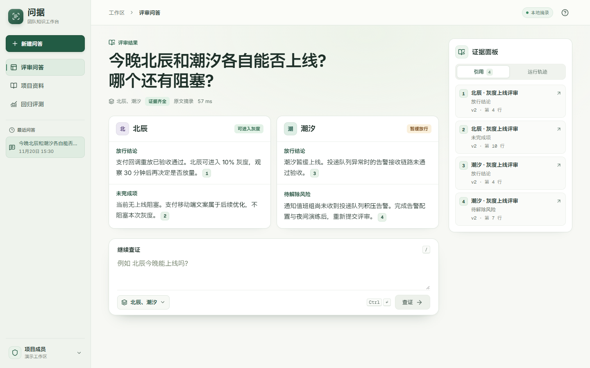
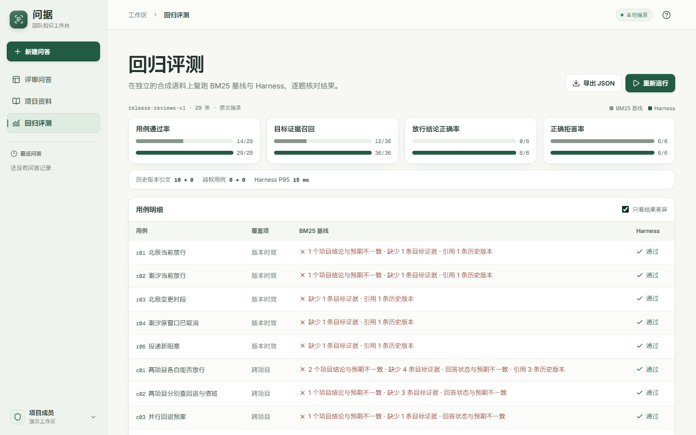

# 问据 · 团队知识工作台

问据（ScopeBrief）是面向单个团队、多项目协作的知识工作台。管理员创建项目并发放一次性邀请，成员按项目权限导入或查阅资料。问答引用可打开当时使用的版本和原文行号。团队可把一条需要复核的回答沉淀为用例，在更新资料后复跑。

> 演示项目、人物和资料均为合成数据。

[查看界面研究与设计决策](docs/DESIGN.md)

## 建立团队工作区

正式模式从空知识库启动，使用独立账号和项目级读写权限。资料支持 Markdown、TXT、文本型 PDF 和 DOCX，单份发布、批量导入、版本冲突检测、归档和恢复都在工作台完成。项目、成员权限和资料变更有操作记录。

有 Docker Compose 时，在仓库根目录启动团队实例并生成首次激活码。

~~~sh
SCOPEBRIEF_DEMO=0 docker compose up --build -d
docker compose exec scopebrief /app/.venv/bin/python -m scopebrief.admin bootstrap
~~~

在 Windows PowerShell 可先运行 `$env:SCOPEBRIEF_DEMO='0'`，再运行上述两条 Docker 命令，其中第一条从 `docker compose` 开始。打开工作台，选「我有邀请码」，输入终端打印的码并设置管理员密码。Python 直跑、数据迁移、备份与 HTTPS 配置见 [团队部署与运维](docs/TEAM.md)。

## 打开合成演示

准备 Python 3.12、[uv](https://docs.astral.sh/uv/getting-started/installation/) 和 Node.js 24。在仓库根目录运行。

~~~sh
uv sync --locked --python 3.12
npm --prefix frontend ci
npm --prefix frontend run build
uv run --locked uvicorn scopebrief.app:app --host 127.0.0.1 --port 8000
~~~

打开 [问据工作台](http://127.0.0.1:8000) 或 [交互式 API 文档](http://127.0.0.1:8000/docs)。首次运行自动载入合成知识库，默认使用原文摘录，无需模型密钥。

有 Docker Compose 的环境也可直接运行 `docker compose up --build`。数据库保存在 `scopebrief_data` 卷中，服务绑定到宿主机的 `127.0.0.1:8000`。

## 三条可演示链路

1. **跨项目查证**。在提问框下方确认项目范围，再点击「跨项目放行」。点开引用核对 v2 原文，再看运行轨迹里的定向补查。
2. **版本与权限**。以项目成员提问「铸桥项目的验收代号是什么？」。切到评审者后重问，再到项目资料发布一版北辰评审。新问题使用新版本，历史运行的引用仍指向原版本。切换角色会销毁当前会话与它的运行历史。
3. **回归评测**。打开「回归评测」并执行，筛选两种策略结果不同的用例，再导出 JSON。评测使用独立的固定语料库，界面发布的资料可以独立演示。

## Harness 如何执行

~~~mermaid
flowchart LR
    UI["React 工作台"] --> API["FastAPI 会话与范围校验"]
    API --> Run["持久化队列 · SSE 轨迹"]
    Run --> Search["授权项目与当前版本 · 全文索引和 BM25"]
    Search --> Check["检查项目覆盖 · 复查放行冲突"]
    Check -->|缺项或冲突| Retry["按项目和资料类型定向补查"]
    Retry --> Context["收集引文 · 限制上下文"]
    Check --> Context
    Context --> Model["模型选择原文 / 直接摘录"]
    Model --> Verify["核对引文 · 输出或拒答"]
    Verify --> Run
    Run -->|SSE| UI
    API --- DB[("SQLite 文档、会话与运行")]
    Search --- DB
    Run --- DB
~~~

- **权限**。服务端从 Cookie 识别账号。SQLite 查询检查该账号的项目权限，在正文、文档版本和运行回放中执行相同的访问约束。
- **时效**。同一项目与文档键下事务内分配递增版本。Harness 先取当前版本，再检索。独立文档的当前结论冲突时，展示双方原文并交给人确认。
- **有界执行**。先做 BM25 初筛，再按所问资料类型补查。单次最多使用 9 条片段、4,000 字原文和一次模型请求。调用失败或校验失败时，保留可核对的原文摘录。
- **可追溯**。团队账号的历史保留到重新登录之后。服务端保存队列、阶段、耗时、结果和引用快照。服务重启后继续执行已排队的任务，被打断的在途任务会显示失败原因。

## 评测结果

下表记录初版 28 条合成回归用例的结果。重新运行评测会包含后续新增用例。两种策略使用相同的问题、项目权限、BM25 打分与原文输出。基线从授权项目的全部版本全局取 Top-4，Harness 增加当前版本过滤和按项目、资料类型补查。

| 指标 | BM25 基线 | 问据 Harness |
| --- | ---: | ---: |
| 用例通过 | 14/28 | 28/28 |
| 目标证据召回 | 11/32 | 32/32 |
| 放行结论正确 | 0/5 | 5/5 |
| 证据不足时正确拒答 | 6/6 | 6/6 |
| 历史版本引文 | 9 | 0 |
| 越权用例 | 0 | 0 |

用例通过要求项目结论、回答状态和目标证据同时符合标注，且没有历史或越权引文。目标证据用「项目 / 文档键 / 版本 / 资料类型」标注。两种策略都施加权限过滤。数据用于复现此场景的已知问题，规模与问题分布都有限。[本地运行报告](docs/evaluation.json)

~~~sh
uv run --locked python -m scopebrief.benchmark --json data/evaluation.json
~~~

## 接入真实模型

将 `.env.example` 复制为 `.env`，填写兼容 Chat Completions 且支持 JSON 对象输出的服务。下面使用本机端点示例。

~~~dotenv
SCOPEBRIEF_MODEL_BASE_URL=http://127.0.0.1:8080/v1
SCOPEBRIEF_MODEL_NAME=qwen2.5-1.5b-instruct
SCOPEBRIEF_MODEL_TIMEOUT=20
# 服务要求鉴权时填写
# SCOPEBRIEF_MODEL_KEY=
~~~

保存后重启 API。模型看到已授权的证据片段和用户问题，负责挑选引文。服务端校验每个引文的编号及连续原文，灰度结论由文档标签和 Harness 规则确定。使用外部模型时，问题和相关片段会发送至该服务。

本机验证使用 llama.cpp 运行 Qwen2.5-1.5B-Instruct Q4_K_M。下载原版模型后可以用下面的命令启动同样的端点。[llama.cpp](https://github.com/ggml-org/llama.cpp) · [Qwen 模型页](https://huggingface.co/Qwen/Qwen2.5-1.5B-Instruct-GGUF)

~~~sh
llama-server --model qwen2.5-1.5b-instruct-q4_k_m.gguf --alias qwen2.5-1.5b-instruct --host 127.0.0.1 --port 8080 --ctx-size 4096
~~~

模型就绪后，在另一个终端跑单条或完整模型评测。

~~~sh
uv run --locked python -m scopebrief.benchmark --case c01 --model
uv run --locked python -m scopebrief.benchmark --model --json data/model-evaluation.json
~~~

实测中 Harness 的 22 条有证据用例都返回了可通过校验的模型引文，其余 6 条按证据不足拒答。这组用例衡量证据检索和校验，模型生成质量还可以单独做盲测。[本地 Qwen 报告](docs/model-evaluation.json)

## 开发与验证

开发时在两个终端分别运行 `uv run --locked uvicorn scopebrief.app:app --reload` 和 `npm --prefix frontend run dev`。Vite 将 API 请求代理至本地 8000 端口。

~~~sh
uv run --locked ruff check .
uv run --locked pytest -q
npm --prefix frontend run build
cd frontend
npx playwright install chromium
npm run test:e2e
~~~

在 Windows PowerShell 可用 `npm.cmd` 与 `npx.cmd`。若已有 Microsoft Edge，可设置 `SCOPEBRIEF_E2E_CHANNEL=msedge` 后运行端到端测试。

| 路径 | 责任 |
| --- | --- |
| `frontend/src/` | 工作台、团队管理、资料库和业务回归 |
| `scopebrief/app.py` · `scopebrief/team_routes.py` | API、会话、SSE 与静态服务 |
| `scopebrief/store.py` · `scopebrief/run_queue.py` | 事务和权限、全文索引、版本和运行队列 |
| `scopebrief/team.py` · `scopebrief/intake.py` · `scopebrief/review.py` | 团队、文件导入、反馈与业务用例 |
| `scopebrief/retrieval.py` · `scopebrief/harness.py` | 中文 BM25、问题路由、证据覆盖与决策规则 |
| `scopebrief/model.py` · `scopebrief/benchmark.py` | 模型适配、引文校验、评测 |
| `scopebrief/fixtures/` | 合成语料、可复跑的标注用例 |
| `tests/` · `frontend/e2e/` | 后端回归与浏览器端到端验证 |

合成演示和正式团队使用独立数据路径。部署边界、文件格式和评测口径见 [团队部署与运维](docs/TEAM.md)。
