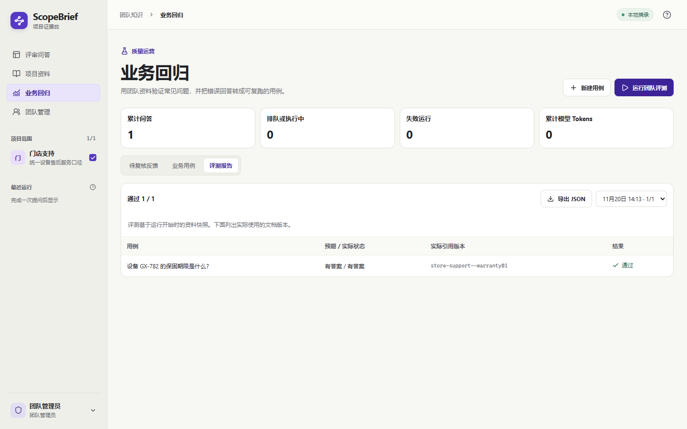

# 团队部署与运维

ScopeBrief 适合单个团队在内网自托管，工作区内可创建多个项目，每位成员有独立账号。正式模式与合成演示分开存储，默认分别使用 `data/team.db` 和 `data/scopebrief.db`。旧演示数据库启动时会升级索引并保留原有资料版本和运行记录。

## 启动与激活

本机已准备好 Python 3.12、uv、Node.js 后，从仓库根目录运行以下 PowerShell 命令。

~~~powershell
uv sync --locked --python 3.12
npm.cmd --prefix frontend ci
npm.cmd --prefix frontend run build
$env:SCOPEBRIEF_DEMO='0'
$env:SCOPEBRIEF_DB='data/team.db'
uv run --locked python -m scopebrief.admin bootstrap
uv run --locked uvicorn scopebrief.app:app --host 127.0.0.1 --port 8001
~~~

打开 [团队工作台](http://127.0.0.1:8001/)，选「我有邀请码」，用终端输出的激活码创建管理员。码只能使用一次，有效期 24 小时。管理员初始化前再次生成会使前一个码失效。之后由管理员发出成员邀请码，有效期 72 小时。

Docker Compose 可在 `.env` 中设置 `SCOPEBRIEF_DEMO=0`，执行 `docker compose up --build -d`，再运行 `docker compose exec scopebrief /app/.venv/bin/python -m scopebrief.admin bootstrap`。容器在宿主机回环地址的 8000 端口提供服务，团队数据库位于数据卷中的 `/app/data/team.db`。工作区正式部署使用单 API 进程，进程内有四个问答执行位。

## 日常工作

1. **团队管理**。创建项目，可加常用别名。按项目邀请只读成员或编辑者。只读成员可查资料、提问并反馈，编辑者还可发布和归档本项目资料。管理员可更新授权或停用账号。已有凭据会话在下一次请求时重新核对权限。
2. **项目资料**。单份导入可在发布前检查提取的正文并填写版本说明。批量导入每批最多 15 份并逐份回报结果。更新已有文档时从最新版本打开编辑，提交时校验编辑基于的版本。归档将整份资料移出新检索，恢复后最新版本重新进入检索。已授权的历史引文可回查。
3. **问答**。选项目后发起查证。队列和轨迹会保存，等待中的任务可取消，已排队任务在进程重启后可继续。被进程中断的任务标记为失败并可重新运行。成员重新登录后，可回看权限范围内的问答。
4. **业务回归**。成员点击「需复核」并描述问题。管理员可把反馈转为用例，设置预计状态、资料及必须出现的引文片段，也可登记日常关键问法。评测从开始时的 SQLite 快照读取用例和现行资料，使用原文摘录模式衡量证据和覆盖。报告保存实际引用版本、失败原因和时间，并支持导出 JSON。

资料接受 Markdown、TXT、文本型 PDF 和 DOCX，单份上限 8 MiB，提取后的正文上限 180,000 字。PDF 页面标题保留在正文里，扫描件请先做 OCR。DOCX 导入正文段落、标题和表格文本。原文件名与可核对的提取文本进入版本记录。[pypdf 文字提取说明](https://pypdf.readthedocs.io/en/stable/user/extract-text.html)

团队检索先在有权限的现行版本内使用 SQLite FTS5 找候选，再按 BM25 和资料类型补查。回答引用的是可核对的文档段落。对常见术语、文档标题和业务编号的查询最稳定，语义改写的覆盖率可用团队回归用例实测。[SQLite FTS5](https://sqlite.org/fts5.html)

## HTTPS 与模型

内网多人共享时，在 HTTPS 反向代理后启动，并启用 `SCOPEBRIEF_SECURE_COOKIE=1`。代理保留请求的 `Host`，对 SSE 路径关闭缓冲。把代理允许的请求体大小配置为至少 8 MiB，服务端仍有单文件和正文长度限制。

默认模型模式为原文摘录。设置 `SCOPEBRIEF_MODEL_BASE_URL` 与 `SCOPEBRIEF_MODEL_NAME` 可接入支持 JSON 结构化输出的 Chat Completions 服务。云端模型会收到本次问题和经授权检索出的片段。内网资料可使用本地推理服务，或继续使用摘录模式。

## 备份和恢复

备份保存成员、项目、资料版本、历史问答和业务回归。目标必须是尚不存在的文件，可放在访问受控的目录。

~~~powershell
uv run --locked python -m scopebrief.admin --db data/team.db backup data/backups/team-2026-11-20.db
uv run --locked python -m scopebrief.admin --db data/team.db reset-password admin-name
~~~

重设密码会撤销该账号现有会话。恢复时先停止团队实例，将 `SCOPEBRIEF_DB` 指向备份的可写副本后启动，抽查一个成员授权、一个现行文档和一条历史引用。用 Compose 部署时，将副本放到数据卷，通过 `SCOPEBRIEF_CONTAINER_DB` 设置容器内路径。备份中的口令哈希和未过期邀请码仍属于工作区数据，需要同等权限保护。
